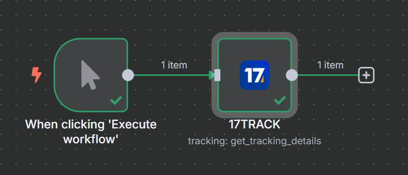
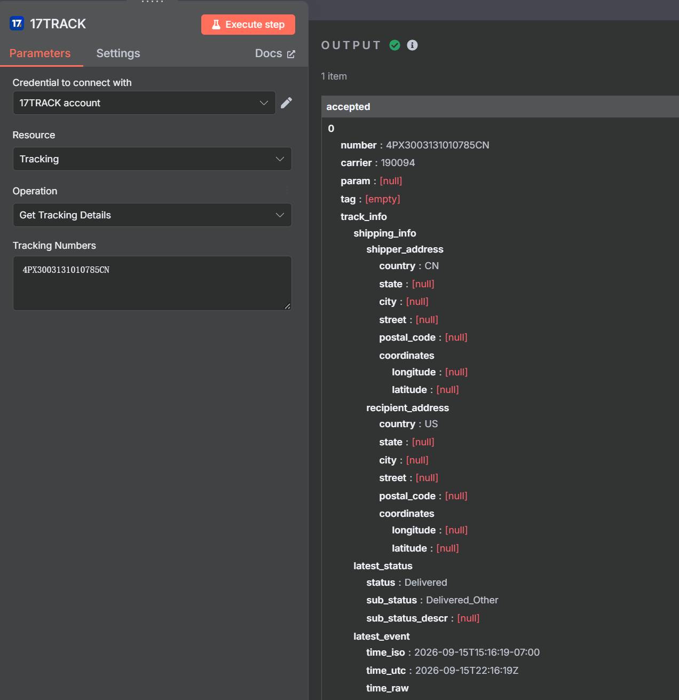

# n8n-nodes-17track

> ⚠️ **Unofficial community package** — not verified by n8n until Creator Portal review.

n8n community node for [17TRACK](https://www.17track.net/) — cross-border e-commerce order
tracking for 3500+ carriers.

## Screenshots

Workflow execution (manual trigger → 17TRACK):

Node output — structured `accepted` / `rejected` variables with full tracking details:

## Operations

Official API doc (11 endpoints): https://asset.17track.net/api/document/v2.4_zh/index.html

- **Register Trackings** — register up to 40 tracking numbers for automatic tracking by 17TRACK
- **Get Tracking Details** — get current tracking details for up to 40 registered tracking numbers
- **List Trackings** — list registered shipments with status and pagination filters
- **Get Quota** — get the current tracking and email quota counters
- **Stop Trackings** — stop automatic tracking for up to 40 registered tracking numbers
- **Restart Trackings** — restart automatic tracking for up to 40 stopped tracking numbers
- **Delete Trackings** — permanently delete up to 40 registered tracking numbers
- **Push Trackings** — queue a webhook push of the latest tracking results
- **Change Carrier** — change the carrier of registered tracking numbers
- **Update Tracking Info** — update the metadata of registered tracking numbers
- **Get Realtime Tracking Details** — query a single tracking number against carriers in real time

## Credentials

`17TRACK API` credential with the API key from
[17TRACK API Settings](https://api.17track.net/admin/settings). The key is sent in the
`17token` header.

## Installation (community node)

Install via n8n Settings → Community Nodes with the package name `n8n-nodes-17track`.

Domain behavior (envelope check, error-code classes, batch limits) is aligned with the
open-source [OpenConnector](https://github.com/oomol-lab/open-connector) 17TRACK provider.

## Publishing note

Per n8n's Creator Portal requirement (from May 1, 2026), publish via GitHub Actions with
a provenance statement — use the publish workflow from the `n8n-nodes-starter` template.
